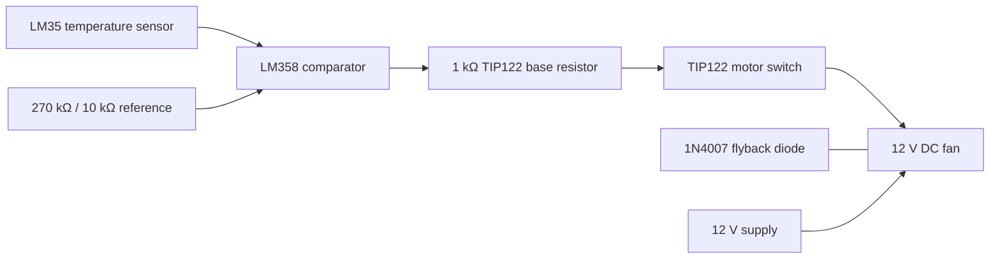

# Circuit architecture and observations

## Signal path

This diagram is a functional approximation; refer to the original Proteus schematic for authoritative pin-to-pin connections.

## Observed pin assignments

- LM35: pin `1` = supply, pin `2` = `VOUT`, pin `3` = ground in the depicted symbol.
- LM358: pin `3` (+) appears connected to adjustable threshold wiper; pin `2` (−) appears connected to LM35 VOUT; pin `1` drives resistor to TIP122 base; pin `8` is the positive supply and pin `4` is ground.
- TIP122: base driven through 1 kΩ, emitter connected to ground, collector connected to the motor low side.
- 1N4007 diode appears across the motor for inductive voltage suppression.
- Red LED and series 1 kΩ resistor appear connected directly between supply and ground, so it is a power indicator rather than a confirmed motor-active indicator.

## Important comparator polarity observation

For a generic comparator without hysteresis, its output tends high if the **non-inverting (+) input** exceeds the **inverting (−) input**. With `Vref` on `+` and `VLM35` on `−`, the output goes high when `Vref > VLM35`, i.e. at relatively *lower* temperatures. If the aim is **fan ON above the set temperature**, reverse these connections so LM35 VOUT goes to `+` and threshold wiper goes to `−`, and then retest. Do not assume that the circuit has been fixed; the delivered Proteus file remains unmodified.

## Reference-range estimate

Assuming a 270 kΩ resistor from +12 V to the 10 kΩ potentiometer's top and the 10 kΩ potentiometer bottom to ground, the top of the potentiometer has approximately:

`12 × 10/(270 + 10) ≈ 0.429 V`

This is about **42.9 °C** of LM35-equivalent voltage, before considering loading and circuit nonidealities. A 50 °C LM35 output is nominally `0.500 V`, higher than this maximum. The exact simulator operating point depends on the configured components and connections; measure the wiper voltage to verify.

## Suggested improvements

1. Choose a reference network supporting the intended switching temperature.
2. Set LM35 to comparator `+` for fan-on-hot behavior.
3. Add comparator hysteresis to prevent oscillation near the set point.
4. Verify the motor's stall current, TIP122 safe operating area and dissipation (`P≈VCE(sat)×I`).
5. Check LM358 output current/high-level voltage and TIP122 base-current requirement.
6. Confirm the flyback diode polarity and adequate motor suppression.
