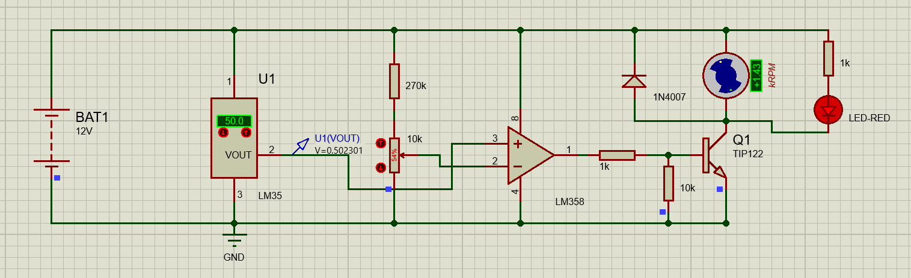
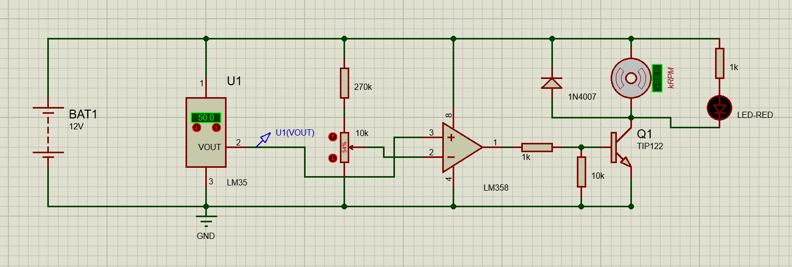

# Temperature-Controlled DC Fan — Proteus

A **temperature-responsive DC fan circuit** designed in Proteus with an **LM35 temperature sensor**, **LM358 op-amp used as a threshold comparator**, and **TIP122 Darlington transistor** for motor switching. No microcontroller or firmware is required.





  

## Overview

The LM35 generates a voltage approximately proportional to Celsius temperature (nominally **10 mV/°C**). The LM358 compares this sensor signal against an adjustable reference derived from the resistor and potentiometer network. The output drives the base of a TIP122 transistor through a resistor, controlling the fan motor's supply path.

**This is intended as an ON/OFF temperature-threshold controller, not a proportional speed controller or PWM fan controller.** Actual motor behavior and switching threshold should be verified in Proteus.

## Screenshots

| Captured circuit state 1 | Captured circuit state 2 |
|---|---|
|  |  |

Both images show the LM35 display at **50.0 °C**. Motor animation/indicator differences alone do not establish temperature-response performance; use the [testing procedure](docs/TESTING.md) to evaluate behavior at multiple temperatures.

## Components visible in the design

| Reference | Device / value | Function |
|---|---|---|
| U1 | LM35 | Temperature sensor; output nominally 10 mV/°C |
| Op-amp | LM358 | Compares sensor and reference voltages |
| Q1 | TIP122 | Low-side NPN Darlington fan driver |
| Motor | DC fan / motor | 12 V actuator/load shown in schematic |
| BAT1 | 12 V DC | Supply |
| D1 | 1N4007 | Motor inductive flyback diode |
| Divider | 270 kΩ and 10 kΩ variable resistor | Adjustable threshold network |
| Base/gate network | 1 kΩ series and 10 kΩ pull-down | TIP122 base control |
| Indicator | Red LED with 1 kΩ resistor | Power indicator in the visible wiring |

## Temperature and voltage

LM35 nominal transfer function:

```text
V_LM35 (volts) = temperature_C × 0.010
50 °C → approximately 0.50 V
```

**Threshold polarity matters:** In the screenshots, the adjustable reference is connected to LM358 non-inverting input (+), while the LM35 output is connected to inverting input (−). Therefore, the ideal comparator output tends HIGH when the **reference exceeds the temperature signal**, not when the temperature exceeds the reference. This is the inverse of a usual *fan turns ON when hot* arrangement. See [wiring observations](docs/CIRCUIT_ARCHITECTURE.md).

## Run in Proteus

1. Clone/download this repository and open [`proteus/Temperature-Controlled Fan.pdsprj`](proteus/Temperature-Controlled%20Fan.pdsprj) in a compatible Proteus version.
2. Check that the sensor, op-amp, transistor, motor and simulation models load successfully.
3. Verify the LM358 supply pins (`8` = positive supply, `4` = GND) and the motor supply.
4. Start simulation; probe LM35 `VOUT`, the potentiometer wiper, LM358 output and TIP122 base/collector.
5. Adjust the LM35's temperature and record the switching point. Check the output *direction* rather than assuming it is correct.
6. Follow [the full test checklist](docs/TESTING.md).

## Repository structure

```text
Temperature-Controlled-Fan-Proteus/
├── README.md
├── .gitignore
├── proteus/
│   └── Temperature-Controlled Fan.pdsprj
├── images/
│   ├── temperature-fan-state-01.png
│   └── temperature-fan-state-02.png
└── docs/
    ├── CIRCUIT_ARCHITECTURE.md
    ├── TESTING.md
    └── SAFETY_AND_LIMITATIONS.md
```

## Limitations

This project is packaged from the supplied native Proteus project and screenshots. **It has not been independently simulated or electrically certified.** The comparator polarity, switching threshold, startup conditions, fan current, op-amp output drive, and TIP122 power dissipation should all be verified before physical construction. The design does not show hysteresis, so chatter near the switching threshold is possible.

## Rights

Files and screenshots supplied by the project owner. No open-source license is granted by default; public access does not grant unrestricted reuse or redistribution.
